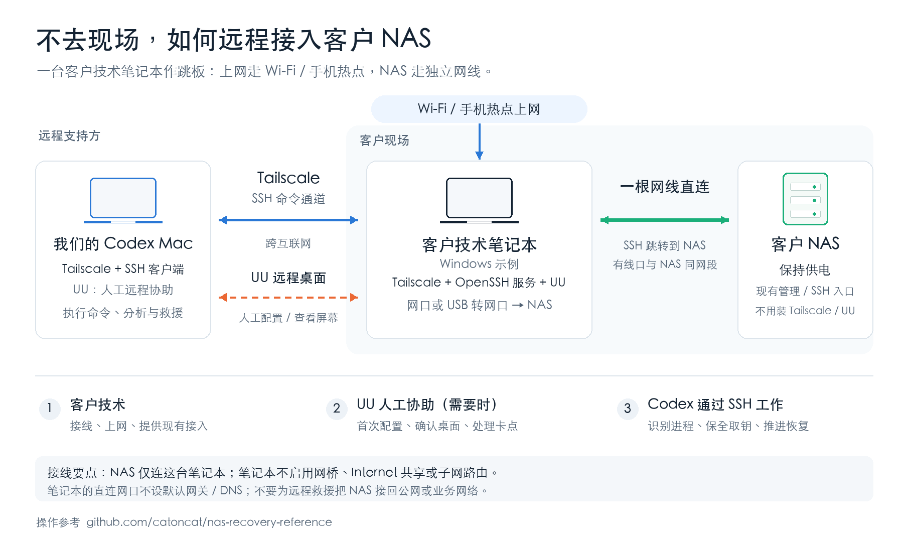

# 无法到现场时：Mac → 客户技术笔记本 → NAS

[原尺寸PNG](../designs/remote-nas-connection/remote-nas-connection.png) · [可编辑SVG](../designs/remote-nas-connection/remote-nas-connection.svg) · [HTML版](../designs/remote-nas-connection/remote-nas-connection.html)

客户现场准备一台干净的技术笔记本（图中以Windows为例）、一根网线；没有网口可用USB网卡。笔记本通过Wi-Fi或手机热点上网，另用网线直接连接NAS。

| 连接/工具 | 在哪里用 | 用来做什么 |
|---|---|---|
| Tailscale | 我们的Mac、客户技术笔记本 | 建立跨互联网的受控连接；通过笔记本已有/开通的OpenSSH服务执行命令或SSH跳转 |
| UU远程协助 | 我们的人工支持端、客户技术笔记本 | 首次配置、查看桌面、处理需要人工操作的卡点；不是Agent执行命令的SSH通道 |
| Wi-Fi / 手机热点 | 客户技术笔记本 | 提供笔记本上网链路 |
| 独立网线 | 客户技术笔记本网口 → NAS | 最后一段现场局域网连接，直连网口与NAS处于同一网段 |

接线后，客户技术提供现有NAS地址/管理入口以及已知现场情况；远程支持可按需要用UU协助把入口接好，之后Codex按 [首次接手指南](FIRST-SESSION.md) 通过SSH读取状态，按 [会话材料获取](KEY-RECOVERY.md) 保全取钥并推进恢复。

Tailscale与UU装在笔记本即可，NAS不需要为了这条路径安装它们。Windows上使用的是普通OpenSSH over Tailscale。SSH跳转/受限端口转发不需要启用笔记本的IP转发、网桥、Internet共享或Tailscale子网路由。笔记本直连网口不设默认网关/DNS，NAS保持供电及原有隔离，不为远程接入重启或接回公网/业务网络。
